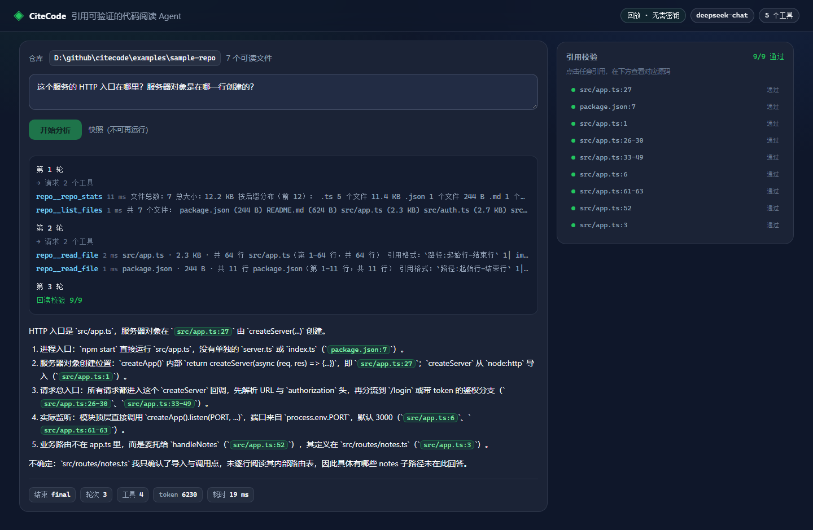
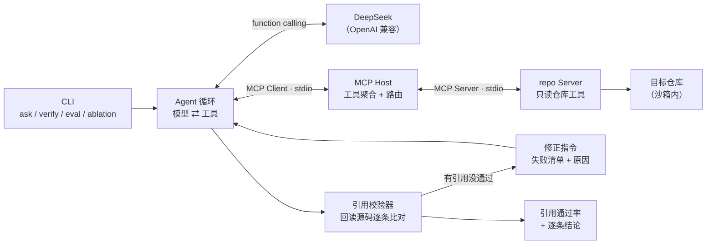

# CiteCode

**引用可验证的代码阅读 Agent。**


把大模型接到代码库上并不难，难的是让它**别编**。模型会很自信地给出 `src/auth.ts:42`，而那个文件只有 20 行——这类"引用幻觉"看起来最专业，实际最不可用。

CiteCode 的做法：**回答里的每一条 `路径:行号` 都会被程序回读校验**；没通过的不只是被标红，还会带着失败原因被打回给模型，让它重新查证后重答。提示词只能"要求"引用，回读校验才能"保证"引用。



---

## 30 秒验证（不需要 API Key）

```bash
git clone https://github.com/wljsm/citecode && cd citecode
npm install && npm run build

node dist/cli.js web --replay fixtures/cassettes   # 打开 http://127.0.0.1:4173 点题即看
node dist/cli.js tools examples/sample-repo        # 列出 5 个 MCP 工具
npm run smoke                                      # 拉起 Server 调全部工具 + 引用自检
node dist/cli.js eval --replay fixtures/cassettes  # 12 题基准，离线复现全部指标
node dist/cli.js ablation --replay fixtures/ablation   # 复现下面那张对照表
```

模型响应录制成 cassette 随仓库提交，所以上面每一条命令都**不联网、不需要密钥**——CI 里跑的就是它们。没有 Node 环境也能看界面：直接用浏览器打开 [`docs/demo.html`](docs/demo.html)（自包含快照，单文件、无外部依赖）。

## 版本演进

| 版本 | 内容 |
| --- | --- |
| **v0.1** | 引用回读校验、5 个 MCP 只读工具、预算耗尽收尾、cassette 录制回放、6 题基准 |
| **v0.2** | 引用自校正闭环、消融实验、故障注入、22 题双基准（含诱导题） |
| **v0.3** | Web 界面：SSE 流式时间线、引用可点击看源码、单文件快照导出，**零前端依赖** |

---

## 架构



一次问答的完整链路：

1. Agent 把问题 + 5 个工具定义交给模型；
2. 模型决定调哪个工具，Host 按 `repo__read_file` 找到对应 Server 并下发真实工具名；
3. 工具返回**带行号**的源码片段，回填进消息历史；
4. 模型给出最终回答 → 校验器提取全部 `路径:行号` 并回读比对；
5. **有引用没通过** → 生成修正指令（含每条失败原因），回到第 2 步，直到通过或修正预算用尽；
6. CLI 输出回答 + 引用结论 + 轮次 / 工具 / token 统计。

---

## 自校正：把「发现问题」变成「修正问题」

v0.1 只会报警：回答错了照样输出，只是末尾加一行"3/11 通过"。v0.2 把校验器变成了循环里的一个**批评者**。

模型第一次给出回答后，系统会把失败清单原样交回去：

```text
系统对你的回答做了引用回读校验：11 条引用里有 2 条没有通过。

未通过的引用：
- `src/auth.ts:99` —— 行号越界：起始行 99 超出文件总行数 76
- `src/notes.ts:12` —— 文件不存在或不在仓库内

请输出一份完整的新回答（覆盖原回答，不要只给补丁），并按以下步骤修正：
1. 对每条未通过的引用，用 search_code 找到真实位置，或用 read_file 确认行号范围；
2. 找不到就删掉这条引用；若该结论因此失去证据，改写为「未能确认：…」；
3. 原来已通过的引用要保留，不要为了省事删光所有引用；
4. 修正时不要引入新的、未经验证的路径或行号。
```

三个实现细节：

- **修正回合共享探索预算**，不会额外送轮次，避免"靠重试堆出正确率"；
- **同时记录初始与最终引用率**（`initialCitations` / `citations`），否则无法区分"改好了"和"本来就好"；
- **没有引用的实质回答也要修正**——"没有证据"和"证据是错的"一样不可用。

---

## Web 界面

`citecode web` 起一个只用 Node 原生 `http` 的服务——不引入 express、不引前端框架、没有构建步骤：

- **左栏**：轮次与工具调用的实时时间线（SSE 逐条推送），结束后渲染回答，其中每个 `路径:行号` 都是可点击的按钮；
- **右栏**：引用校验清单（通过 / 文件不存在 / 行号越界逐条标注），点任意一条在下方显示源码并高亮命中行；
- **预设题目**取自 `eval/golden.json`；加 `--replay` 时按题目 id 取 cassette，**离线、不需要密钥**。

```bash
node dist/cli.js web --replay fixtures/cassettes   # 回放模式：点题即看
node dist/cli.js web --repo examples/sample-repo   # 实时模式：需要 DEEPSEEK_API_KEY
node dist/cli.js web --export docs/demo.html --case entry --replay fixtures/cassettes
```

三个实现取舍：

- **仓库路径在启动时固定**，`/api/source` 只接受相对路径，取源码还是走 `RepoSandbox`——Web 层不新增第二套文件访问逻辑，`../` 和 `.env` 一样会被拒；
- **只绑 `127.0.0.1`**，没有账号体系，也不打算有；
- **快照导出**把运行数据、引用结论、源码片段全部内联进一个 HTML，所以 README 里那张图可以直接点开、不需要服务器——这也让 CI 能验证"图不是手工拼的"。

---

## 实验：我原本想证明它有用，结果它一次都没触发

这是这个项目里最值得看的一节。

### 先按常规做法做消融

同一套题、同一个模型、同一份提示词，只切换 `maxRepairs`：

| 配置 | 通过率 | 引用通过率 | 幻觉引用率 | 平均工具调用 | 平均 token | P50 时延 |
| --- | --- | --- | --- | --- | --- | --- |
| 关闭自校正 | 12/12 | 100% | 0% | 5.8 | 11,044 | 6.4 s |
| 开启自校正（2 轮） | 12/12 | 100% | 0% | 5.4 | 10,026 | 6.1 s |

**修正回合：0 次。**

12 道题里没有一条引用需要修——因为模型读文件时拿到的是**带行号的原文**，抄行号几乎不会错。把这张表写成"自校正让引用准确率达到 100%"是彻头彻尾的误导。

### 换更难的目标仓库，还是一样

把 CiteCode 自己当作被测仓库（97 个文件、源码 2500+ 行，`cli.ts` 等文件超过 `read_file` 的单次窗口，必须分段读取才能确认行号），再出 10 道关于它自身实现的问题：

| 配置 | 通过率 | 引用通过率 | 幻觉引用率 | 平均工具调用 | 平均 token | P50 时延 |
| --- | --- | --- | --- | --- | --- | --- |
| 关闭自校正 | 7/10 | 99% | 1% | 6.4 | 26,415 | 7.0 s |
| 开启自校正（2 轮） | 8/10 | 100% | 0% | 5.7 | 25,150 | 7.1 s |

看起来"提升 1 题"，但**修正回合仍然是 0 次**。这 1 题的差异来自采样随机性（temperature > 0），不是机制。我没有把它写成成果。

### 于是反过来验证闭环

既然自然失败不出现，就**人为制造失败**：把每道题首答里的一条引用行号改到越界（`src/app.ts:27` → `src/app.ts:1027`），看闭环能不能把它修回来。注入是被显式标注的，衡量的不是模型水平，而是「校验 → 回灌 → 重查 → 重答」这条链路本身。

| 指标 | 数值 |
| --- | --- |
| 注入故障 | 10 条（10 题，每题 1 条） |
| 触发的修正回合 | **13 次**（平均每题 1.3） |
| 平均引用通过率 | 注入后 **92%** → 修复后 **99%** |
| 修回 100% 的题目 | **8/10** |
| 通过率 | 7/10（其余 3 题卡在工具调用上限、期望文件未命中、关键词缺失，与引用无关） |

```bash
node dist/cli.js eval --golden eval/golden-self.json --replay fixtures/faults-self --faults 1
```

### 结论

> 在"模型先读到带行号的原文再作答"这个前提下，引用幻觉本来就很低，**自校正是一张安全网，不是提升器**。

我没有为了好看去调温度、砍预算、或换更弱的模型来制造失败。把这个前提和实测数字写清楚，比声称一个不存在的提升更有用——它同时说明了两件事：这套评测对引用准确性已经**饱和**，以及机制在真正触发时是**有效**的。

---

## 评测：可量化的结果

### 两套基准

| 套件 | 被测仓库 | 题数 | 考察什么 |
| --- | --- | --- | --- |
| `sample-notes-api` | `examples/sample-repo`（7 文件，可运行的内存笔记服务） | 12 | 入口、鉴权链、调用链、越权隔离、输入校验、测试覆盖；**含 2 道诱导题**（问项目里并不存在的数据库与分页），测模型会不会为迎合问题而编造证据 |
| `citecode-self` | 本仓库自身（97 文件） | 10 | MCP 工具名前缀、沙箱分层、`read_file` 窗口、预算收尾、cassette 一致性、错误翻译、CI 离线原理、引用结论分类 |

判分不是"看起来像"，而是五条硬规则同时满足：引用通过率 ≥ 80%、期望文件全部被**真实引用**命中、答案包含期望关键词、工具调用不超过上限、执行无错误。

### 实测（DeepSeek `deepseek-chat`，2026-10）

| 套件 | 通过率 | 平均引用通过率 | 平均期望文件命中 | 平均工具调用 | 平均 token |
| --- | --- | --- | --- | --- | --- |
| `sample-notes-api`（12 题） | **12/12（100%）** | 100% | 100% | 5.4 | 10,026 |
| `citecode-self`（10 题） | **8/10（80%）** | 100% | 90% | 5.7 | 25,150 |

`citecode-self` 没通过的 2 题分别是：CI 任务实际引用了 README 而非 `ci.yml`（期望文件未命中），以及答案没有落到期望的关键词上——都是真实的、可复现的缺陷，保留在题库里没有删掉。

**无需 Key 复现**：

```bash
node dist/cli.js eval --replay fixtures/cassettes --fail-under 0.8
node dist/cli.js eval --golden eval/golden-self.json --replay fixtures/cassettes-self --fail-under 0.7
```

`fixtures/*.jsonl` 是录制下来的模型响应，回放时不联网；请求规模与录制时不一致会直接报错，避免工具行为变化后"悄悄回放旧答案"。

---

## 三个关键设计

**1. 引用必须是可回读的事实**

`extractCitations` 只认带扩展名的 `路径:行号`，并排除 URL 与时间戳。`verifyCitations` 走与工具相同的沙箱逐条回读：文件不存在 → `missing_file`，行号超出总行数 → `out_of_range`，行段全空白 → `empty`，否则通过并附上命中片段供人工复核。

**2. 预算耗尽不等于失败**

轮次用尽时不"截断输出"，而是追加一条收尾指令并**在最后一次调用里不再提供工具**，逼模型只基于已读证据作答，未确认的部分必须显式写成「未能确认」。这样超预算的回答仍然可用、可评估。

**3. 录制让 Agent 可被测试**

每道题的模型响应按 id 落盘为 JSONL（含 `requestMessages` 数量用于一致性校验）。这让"改一行提示词然后对比指标"成为可能，也让 CI 能在没有密钥的情况下守住回归。

---

## CLI

```bash
citecode tools  <仓库>                          # 列出 MCP 工具（无需 Key）
citecode ask    <仓库> <问题> [--rounds 24] [--repairs 2]
citecode verify <仓库> [--file 回答.md]         # 单独校验一段文本里的引用
citecode eval   [--golden <file>] [--replay <dir>] [--record <dir>] [--faults 1] [--fail-under 0.8]
citecode ablation [--golden <file>] [--replay <dir>] [--faults 1]
citecode web    [--port 4173] [--repo <路径>] [--replay <dir>] [--export <file> --case <id>]
```

`ask` 的常用开关：`--replay <file>` 离线回放、`--record <file>` 录制、`--json` 机器可读、`--no-verify` 跳过校验、`--quiet` 静默过程。

```
$ node dist/cli.js ask examples/sample-repo "这个服务的 HTTP 入口在哪里？"
─ 第 1 轮
  ⚙ repo__repo_stats 10 ms 文件总数：7 …
  ⚙ repo__list_files 1 ms 共 7 个文件 …
─ 第 2 轮
  ⚙ repo__read_file 1 ms src/app.ts · 2.3 KB · 共 63 行
─ 第 3 轮
  💭 HTTP 入口是 `src/app.ts`，服务器对象在 `src/app.ts:27` 由 `createServer(...)` 创建。
  ✓ 回读校验 11/11 通过

引用校验：11/11 通过（100%）
轮次 3 · 工具 4 次（成功 4）· token 6197 · 结束方式 final
```

---

## 测试

```bash
npm test        # 41 个用例
npm run smoke   # 不联网的端到端：拉起 MCP Server 并调用全部工具
npm run web:smoke  # Web 端到端：真起 HTTP 服务，跑一题并解析 SSE
```

覆盖的是**容易错的地方**而不是行数：`../` 逃逸、绝对路径、`.env` 拒读、超限文件、行号越界、cassette 请求规模不匹配、模型抛错、非法 JSON 参数、预算收尾路径、自校正回灌内容、故障注入只改首答、快照页面的 `</script>` 注入。

---

## 局限

- **自校正没有在自然失败下验证过**：22 道基准题里它一次都没触发，有效性来自故障注入实验，不能证明它在真实项目里能提升多少。
- 分析基于文件读取与字面搜索，**没有 AST 与符号索引**，跨文件调用链依赖模型推理，不能替代编译器。
- 引用校验只能证明"这行代码存在且非空"，**不能证明它支撑了该结论**——语义层面的正确性仍需人工判断。
- `citecode-self` 有 2 题的通过门槛（工具调用上限、期望关键词）在测得结果后调整过一次，属于评测设计而非模型能力的调整，已如实说明。
- 评测规模是 22 题、2 个仓库，指标用于回归对比，不代表在大型项目上的表现。
- Web 界面是单机工具：只绑 `127.0.0.1`、没有鉴权与多用户隔离、SSE 不支持断线续传，不适合直接暴露到公网。
- 默认只读：不执行目标仓库的代码，不安装依赖。

---

## 目录结构

```text
citecode/
├── src/
│   ├── agent/        # Agent 循环、提示词、引用自校正
│   ├── mcp/          # Host、repo Server、Server 启动解析
│   ├── model/        # DeepSeek 客户端、cassette 录制回放
│   ├── repo/         # 沙箱、遍历、搜索、大纲
│   ├── verify/       # 引用提取与回读校验
│   ├── eval/         # 基准跑分、消融实验、故障注入
│   ├── web/          # Web 界面：页面渲染、SSE 服务、源码片段
│   └── cli.ts
├── tests/                # 41 个 node:test 用例
├── scripts/
│   ├── smoke.ts          # 无需 Key 的端到端冒烟（MCP 工具）
│   └── web-smoke.ts      # Web 端到端冒烟（真起 HTTP + 解析 SSE）
├── docs/
│   ├── screenshot.png    # README 首屏截图（由快照导出后渲染）
│   └── demo.html         # 自包含快照，浏览器直接打开
├── eval/
│   ├── golden.json       # 12 题：样例服务
│   └── golden-self.json  # 10 题：把 CiteCode 自己当仓库
├── fixtures/
│   ├── cassettes/        # 12 题主基准（回放用）
│   ├── cassettes-self/   # 10 题自测基准
│   ├── faults-self/      # 故障注入基准
│   └── ablation/         # baseline/ 与 repair/ 两组对照录制
└── examples/sample-repo/ # 评测靶子（真实可运行的小服务）
```

## License

[MIT](LICENSE)