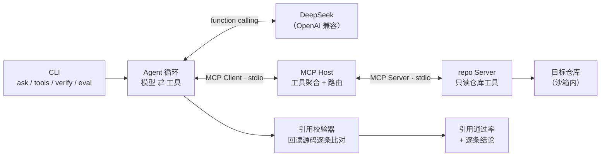

# CiteCode

**引用可验证的代码阅读 Agent。**


把大模型接到代码库上并不难，难的是让它**别编**。模型会很自信地给出 `src/auth.ts:42`，而那个文件只有 20 行——这类"引用幻觉"看起来最专业，实际最不可用。

CiteCode 的做法：**回答里的每一条 `路径:行号` 都会被程序回读校验**，不存在的文件、越界的行号会被逐条标红，并汇总成可量化的「引用通过率」。提示词只是"要求"引用，回读校验才是"保证"引用。

## 核心能力

| 能力 | 实现 |
| --- | --- |
| **引用回读校验** | 解析回答中的 `路径:行号`，回读源码，判定通过 / 文件不存在 / 行号越界，输出通过率 |
| **可复现评测** | 内置 6 题基准（入口、鉴权、调用链、越权、测试），一键跑分并输出指标 |
| **离线回放** | 模型交互录成 cassette，CI 与演示完全不联网、不需要 API Key |
| **MCP 只读工具** | 独立 stdio Server，5 个工具：`list_files` / `read_file` / `search_code` / `outline` / `repo_stats` |
| **三层路径沙箱** | 拒绝绝对路径、拒绝 `..` 逃逸、软链按真实路径二次校验，密钥文件一律拒读 |
| **预算耗尽收尾** | 工具预算用尽时不硬截断，而是强制模型基于已有证据作答并标注缺口 |
| **多 Server 路由** | Host 聚合工具并加 `server__tool` 前缀，模型侧名字与真实工具名解耦 |

## 架构



一次问答的完整链路：

1. Agent 把问题 + 5 个工具定义交给模型；
2. 模型决定调用哪个工具，Host 按 `repo__read_file` 找到对应 Server 并下发原始工具名；
3. 工具返回**带行号**的源码片段，结果回填进消息历史；
4. 模型给出最终回答，校验器提取所有 `路径:行号` 并回读比对；
5. CLI 输出回答 + 引用结论 + 轮次 / 工具 / token 统计。

## 快速开始

```bash
git clone <your-repo-url> citecode
cd citecode
npm install
npm run build
```

**不需要 API Key 就能验证 MCP 链路：**

```bash
node dist/cli.js tools examples/sample-repo   # 列出 5 个工具
npm run smoke                                 # 依次调用 5 个工具 + 引用自检
```

**接入模型：**

```bash
cp .env.example .env      # 填入 DEEPSEEK_API_KEY=sk-...
node dist/cli.js ask examples/sample-repo "这个服务的 HTTP 入口在哪里？服务器对象是在哪一行创建的？"
```

## 一次真实运行

```
─ 第 1 轮
  💭 我先看一下仓库结构。
  ⚙ repo__repo_stats 10 ms 文件总数：7 …
  ⚙ repo__list_files 1 ms 共 7 个文件 …
─ 第 2 轮
  ⚙ repo__read_file 1 ms src/app.ts · 2.3 KB · 共 64 行
─ 第 3 轮
  💭 HTTP 入口是 `src/app.ts`，服务器对象在 `src/app.ts:27` 由 `createServer(...)` 创建。

回答
HTTP 入口是 `src/app.ts`，服务器对象在 `src/app.ts:27` 由 `createServer(...)` 创建。
…
引用校验：11/11 通过（100%）
  ✓ src/app.ts:27    — 通过
  ✓ src/app.ts:61-63 — 通过
  …
轮次 3 · 工具 4 次（成功 4）· token 6323 · 结束方式 final
```

## 评测：可量化的结果

`examples/sample-repo` 是一个几十行的内存笔记服务（HTTP 入口 / 鉴权 / 路由 / 存储 / 测试），6 道题覆盖不同推理类型：

| 题号 | 问题 | 引用通过率 | 工具调用 | 时延 |
| --- | --- | --- | --- | --- |
| `entry` | HTTP 入口与服务器创建位置 | 100% | 4 | 4.0 s |
| `login-chain` | 登录密码校验与 token 签发链路 | 100% | 6 | 8.0 s |
| `create-note` | 创建笔记的调用链 | 100% | 6 | 6.2 s |
| `auth-guard` | 缺 token 时的响应与判断位置 | 100% | 4 | 4.4 s |
| `ownership` | 越权隔离在哪一层保证 | 100% | 8 | 7.6 s |
| `tests` | 测试覆盖了哪些行为 | 100% | 7 | 9.1 s |

**汇总**（DeepSeek `deepseek-chat`，2026-10 实测）：

| 指标 | 数值 |
| --- | --- |
| 通过率 | **6/6（100%）** |
| 平均引用通过率 | **100%** |
| 平均期望文件命中 | 100% |
| 平均工具调用 | 5.8 次 |
| 平均 token | 11,188 |
| P50 时延（实时 / 回放） | 6.2 s / 9 ms |

判分不是"看起来像"，而是四条硬规则同时满足：引用通过率 ≥ 80%、期望文件全部被真实引用、答案包含期望关键词、工具调用不超过上限。

**无需 Key 复现全部指标**：

```bash
node dist/cli.js eval --replay fixtures/cassettes --fail-under 0.8
```

`fixtures/cassettes/*.jsonl` 是录制下来的模型响应，回放时完全不联网——所以同一条基准在 CI 里也能跑，且结果一致。

## 三个关键设计

**1. 引用必须是可回读的事实**

`extractCitations` 只认带扩展名的 `路径:行号`，并排除 URL 与时间戳。`verifyCitations` 走与工具相同的沙箱逐条回读：文件不存在 → `missing_file`，行号超出总行数 → `out_of_range`，行段全空白 → `empty`，否则通过并附上命中片段供人工复核。

**2. 预算耗尽不等于失败**

预算用完时不做"截断输出"，而是追加一条收尾指令并**在最后一次调用里不再提供工具**，逼模型只基于已读证据作答，未确认的部分必须显式写成「未能确认」。这样超预算的回答仍然可用、可评估。

**3. 录制让 Agent 可被测试**

每道题的模型响应按题目 id 落盘为 JSONL（含 `requestMessages` 数量用于一致性校验）。回放时若请求规模与录制时不一致会直接报错——避免工具行为变化后"悄悄回放旧答案"。

## CLI

```bash
citecode tools  <仓库>                         # 列出 MCP 工具（无需 Key）
citecode ask    <仓库> <问题> [--rounds 16]    # 提问，自动校验引用
citecode verify <仓库> [--file 回答.md]        # 单独校验一段文本里的引用
citecode eval   [--replay <dir>] [--record <dir>] [--fail-under 0.8]
```

`ask` 的常用开关：`--replay <file>` 离线回放、`--record <file>` 录制、`--json` 机器可读输出、`--no-verify` 跳过校验、`--quiet` 静默过程。

## 测试

```bash
npm test        # 27 个用例：引用解析、沙箱逃逸、搜索行号、大纲、cassette、Agent 循环
npm run smoke   # 不联网的端到端：拉起 MCP Server 并调用全部工具
```

测试覆盖的是**容易错的地方**而不是行数：`../` 逃逸、绝对路径、`.env` 拒读、超限文件、行号越界、cassette 不匹配、模型抛错、非法 JSON 参数、预算收尾路径。

## 局限

- 分析基于文件读取与字面搜索，**没有 AST 与符号索引**，跨文件调用链依赖模型推理，不能替代编译器。
- 引用校验只能证明"这行代码存在且非空"，**不能证明它支撑了该结论**——语义层面的正确性仍需人工判断。
- `outline` 是正则实现，不支持嵌套作用域与泛型。
- 评测规模是 6 题、1 个样例仓库，指标用于回归对比，不代表在大型项目上的表现。
- 默认只读：不执行目标仓库的代码，不安装依赖。

## 目录结构

```text
citecode/
├── src/
│   ├── agent/        # Agent 循环、提示词
│   ├── mcp/          # Host、repo Server、Server 启动解析
│   ├── model/        # DeepSeek 客户端、cassette 录制回放
│   ├── repo/         # 沙箱、遍历、搜索、大纲
│   ├── verify/       # 引用提取与回读校验
│   ├── eval/         # 基准跑分
│   └── cli.ts
├── tests/            # node:test 用例
├── scripts/smoke.ts  # 无需 Key 的端到端冒烟
├── eval/golden.json  # 基准题库
├── fixtures/cassettes/  # 录制的模型响应（回放用）
└── examples/sample-repo/ # 评测靶子（真实可运行的小服务）
```

## License

[MIT](LICENSE)
